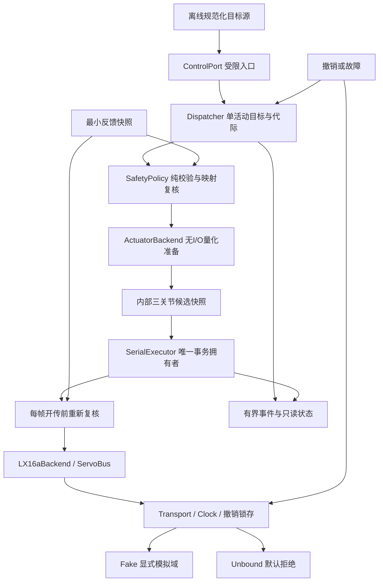

# M1执行链与硬件抽象层实施方案

日期：2026-10-24（Asia/Shanghai）。版本：评审候选v0.1。**状态：DESIGN_REVIEW / AWAITING_USER；尚未授权开始M1开发。**

用户已接受M0当前sanitizer覆盖限制；该决定不表示sanitizer通过，也不等于批准本方案。设计源基线为 `46618c7d93cd2efda27a67c2232e38b8ab6608b1`，其中firmware与原始27项清单相同。开发启动时，每个任务须重新绑定上一个已接纳提交的精确SHA。

## 1. M1完成后应得到什么

一个可以在假硬件上重复验证的三关节执行链：接收规范化目标，先检查三关节完整候选，再逐帧复核和发送；disarm、cancel、故障、看门狗或配置变化后，旧目标不能继续启动运动；已经发送的部分能够准确报告，不声称可以回滚或保证物理停止。

M1实现平台HAL合同与Fake/Unbound适配、一个LX-16A设备后端、受限ControlPort、目标/会话管理、纯安全校验、单事务执行器及最小事件记录。全部成功路径使用显式Synthetic域，默认Physical域仍不可使能。

M1不实现STM32 UART/DMA/GPIO驱动、引脚/时钟配置、第二种真实电机、真实遥控协议、四腿、步态、配置文件解析、周期遥测调度、日志导出/回放。现有底层读指令继续保留并回归，但自动读取与监督调度在M2完成。平台HAL合同通过不等于板级驱动通过。

## 2. 组件职责及替换边界

M1的SerialExecutor是未来BusScheduler的最小版本，不额外创建第二个总线拥有者。ControlRuntime在同一线程驱动这些对象，运行期不分配动态内存、不阻塞等待、不调用任意应用回调；后端不缓存待发运动、不自动重试。

| 边界 | M1职责与交付 | 更换对象时的影响 |
|---|---|---|
| 平台HAL | 同一时基的Clock、非阻塞TX/RX、逐字节到达时间/错误、UART完成、缓冲释放、撤销锁存；Fake与Unbound实现 | 换MCU/OS时实现平台合同并补板测；控制策略与电机协议不改 |
| 设备后端 | 描述模式/反馈/停止能力；执行器坐标量化、逆量化、地址验证、LX-16A帧及响应解释 | 换电机时替换后端和设备绑定、重验能力/映射；核心不携带LX帧、ID上限或tick范围 |
| 输入边界 | ControlIntent及离线源替身，验证来源/会话/序号/原始时间；只调用ControlPort | 将来更换输入协议只需转成同一意图；解码不能arm、直发或给旧输入重写时间 |

上层只使用逻辑关节、rad、rad/s、ms。机构JointMapping与设备量化分开：关节rad → 独立线性执行器坐标 → 后端量化 → 反解实际关节rad → 复核限位/步幅/速度。执行器坐标的单位由绑定明确声明；M1的LX-16A采用角位置映射，未来不兼容单位/模式须拒绝，不能默认为同一类电机。

替换性用一个无LX字节依赖的测试后端证明，改变其量化粒度和能力即可复用同一执行链；不为证明可替换性提前实现CAN/PWM驱动。Unknown与Unsupported均拒绝必需能力；“支持发送stop”与“已验证物理停止”分别记录。

M1最小位置控制配置明确要求Position命令、可读位置反馈、协议级stop和满足资源释放合同的平台；命令ACK不是必需项，LX-16A写命令按已知无ACK处理。温度/电压/加载能力如实描述，周期监督留M2；不会以Unknown伪造反馈。协议级stop已知可编码不等于物理停止已验证，Physical域还须硬件证据，当前不满足。

## 3. 关键数据和接口合同

下列名称为语义约定；正式C++文件/签名可在对应任务内调整，但不能弱化边界。

| 对象/操作 | 语义 |
|---|---|
| ControlIntent | source_id、source_session、Runtime签发的control_session、uint64 sequence、原始created_ms、Position模式、3个关节rad和duration_ms；绑定当前来源和本次arm会话 |
| ControlEpoch | 内部uint64撤销代际；disarm/cancel/fault、成功配置变更、新会话等使旧工作失效；不能由应用提供valid=true替代 |
| ConfigSnapshot | 不可变类型化配置，含revision、平台/后端/映射绑定代际、单位、能力需求、Synthetic/Physical域；M1不解析文件 |
| FeedbackSnapshot | 3项关节值及各自来源、有效性、同一时基样本时间、配置绑定；最旧项决定有效期；命令/预测不冒充测量 |
| PreparedTarget | 内部固定3项、不可由应用构造；绑定完整输入身份、原始时间、控制代际、配置/绑定版本及量化后结果；不构成持久发送许可 |
| submit_target | 只接受完整合法且当前有空槽的目标，Accepted仅表示接纳；没有I/O。类型化拒绝包括Busy、Replay、WrongSession、InvalidInput、NotArmed等 |
| prepare | 后端无I/O、无状态副作用地验证能力与可表示值，返回可供核心反向复核的量化结果；不能提前发送 |
| try_start / poll / cancel | 仅唯一执行器调用；结果绑定事务ID，拒绝新start不能把上一事务Reply当成新结果或破坏当前活动事务 |
| ExecutionStatus | 按关节保存NotStarted、StartedOutcomeUnknown、WriteSent及停止尝试结果；总目标保存原因与部分执行范围。M1不产生AtTarget/PhysicallyStopped结论 |

反馈入口仅由Runtime绑定的可信提供者更新，普通目标源不能提供“测量已验证”标记。M1测试注入Synthetic快照，Runtime、配置、后端、反馈的域必须一致；Synthetic数据不能使Physical路径ready。M2在此合同上增加TelemetryStore和真实读回复处理。

会话、配置、目标与事务计数使用uint64严格单调，耗尽前拒绝继续并保持禁止输出，不自然回绕。新进程清空所有缓存、默认Disarmed，建立新来源会话后才能接收输入。M1一次绑定一个来源会话，换来源需Disarmed，不做多控制器仲裁。sequence的单调性作用于(source_id, source_session)，重复arm不重置防重放状态；从Disarmed成功arm会提升内部控制代际并签发新的control_session。旧输入即使从未成功接纳，也不能跨arm会话补发。

## 4. 接纳、看门狗与配置规则

1. **一个活动目标，无待处理槽。** 这里“活动”指三帧尚未发送完，不等待舵机运动duration结束；三帧WriteSent后释放目标槽，但保留每关节最后执行记录及可能受影响设备集合。Busy时的新目标明确拒绝，不更新看门狗，不影响正在发送的三帧。M2再设计最多一个latest待处理槽。目标结束不清除本会话的防重放记录。
2. 接纳时先检查来源、会话、严格递增序号、原始时间及三关节完整候选，全部成功才一次提交快照及输入存活依据。相同数值但新身份、新鲜时间的输入可接受；同序号、乱序或失败输入不可续期。
3. source created_ms必须来自已转换到本机同一时基的时间，不能早于本次arm建立时刻。按半周回绕规则比较，比上一接纳输入更旧的created_ms拒绝；相同created_ms但新序号可以接受，存活截止期仍不后移。更大序号不能把旧时间洗新。M1内部源不处理远端时钟同步。
4. 首次arm建立独立的first_input_timeout；重复arm不刷新。第一条新输入接纳后，持续看门狗按该输入的原始created_ms计算，不按plan、poll或接纳时刻计算。新目标接纳时同时满足target_timeout和watchdog窗口。
5. uint32时间窗口为1..2^31-1ms，年龄达到窗口即过期；未来时间、非法半周窗口拒绝，合法小回绕按无符号年龄计算。平台须保证时基连续且服务间隔不跨半周；时钟复位/连续性失效上报故障、撤销会话，不能把复位解释为正常回绕。
6. 输入身份/重复/Busy等拒绝不破坏当前合法目标。有效来源的全新目标若包含NaN/Inf、超限、非法时长等安全违规，则拒绝并在Armed时锁存故障，保留原SafetyGate的保守策略；任何反馈失效、超时、平台错误均走故障撤销。纯SafetyPolicy只返回原因，不自行写状态；状态机统一处理。
7. 配置变更仅在Disarmed、无活动事务/待处理stop且无待恢复平台故障时允许。先在独立候选完整校验；失败保留上一完整配置且不自动arm；成功整体替换、提升revision并使旧目标失效。Fault时须先满足恢复/清故障条件。后端或平台身份变化也必须撤销旧绑定和验证证据，不把ready沿用到新设备。

待讨论的策略是上述Busy拒绝、首输入独立宽限、配置失败保留旧完整配置。这些是候选约定，尚未实现。

M1目标源须遵守Accepted/Busy回压，不把“收到报文”当成“控制目标已接纳”。设计配置要记录三帧发送及最大服务间隔的保守预算，使其小于所选输入/目标有效窗口；该预算来自Synthetic测试或后续实测，不能猜硬件参数。预算超限拒绝配置/目标，不通过让Busy输入续命掩盖阻塞。即使没有活动目标，看门狗仍持续监督Armed状态；三帧已发但长动作尚可能继续时发生超时，仍锁存Fault，对保留的可能受影响设备走受限stop并报告物理未知。

已启动过运动且执行器状态仍未知时，禁止改变设备地址/后端/平台绑定来消除旧状态；停止记录绑定原设备快照，不能拿新映射解释旧设备。M1仅由明确Synthetic静止/复位证据解除该绑定限制；Physical域需要未来人工/硬件准入证据，不能靠收到stop的WriteSent或配置成功消除不确定性。

## 5. 每帧发送的完整顺序

1. poll开头优先处理已锁存撤销/故障，再推进一个活动事务及有界接收事件；不得先启动下一帧再处理撤销。
2. 到本帧时重新读取时钟、状态、ControlEpoch、来源会话、配置/绑定版本和最新完整反馈。检查当前目标仍有效、最旧反馈未过期、输入看门狗有效、后端/总线可用，并复核实际量化关节值的限位/步幅/速度。
3. prepare/编码/必要的RX清理均不得在最终复核后隐藏一次延迟发送；最终提交链同步到实际TX开始，不转交另一个队列。准备或清理失败不能刷新目标身份/时刻。
4. 核心把本次操作的撤销代际和最早失效边界传入内部一次性发送门控。HAL只理解通用“允许/撤销/有效时间界限”，不理解电机或关节策略。最后一次时钟/撤销锁存检查与启动外设须形成平台明确的提交边界；复核后的等待不能越过失效时刻再开传。
5. Fake分别在“核心复核前”“核心复核后、平台提交前”“平台已提交后”注入撤销。前两者begin_tx实际启动计数必须为0；提交后按可能已上线路处理，立即取消并禁止后续move。未来STM32用经过板测的临界区/锁存方案实现相同合同；M1不假定普通单线程代码能屏蔽ISR。
6. 一次poll最多启动一项操作，固定顺序Joint0→Joint1→Joint2，不表示三个关节同时运动。每次实际开始均记录时间、事务与目标身份、配置代际、关节和精确字节。

事件账本区分“提交尝试”“最终begin_tx实际启动”“UART完成”。撤销在提交前到达时可记录一次被拒绝尝试，但D组要求的运动begin_tx启动计数仍为0；不能用尝试次数冒充实际发送，也不能不记已提交但结果未知的发送。

不存在可由应用复用的“已校验帧”。公共头文件只提供ControlPort和只读状态，LX帧与raw bus留在后端/低层测试；该边界防误用，不宣称能防恶意C++代码。

## 6. HAL必须先解决的细节

### 6.1 发送与缓冲寿命

- `begin_tx`区分明确未启动、已启动、可能已启动；只有明确未启动证据才能保持NotStarted，bool false不能一律解释为零字节。DMA完成仍是Busy，最后停止位离开UART后才是WireComplete；随后才能切换接收方向。WireComplete一旦观察到就不降级：例如后续enter_rx/清理失败，应保留该关节WriteSent并另记平台故障，不能把已知已发改成未发；写出仍不是设备ACK。
- **内存释放与线路停止分开。** cancel/abort返回前，必须解除对调用者缓冲区的所有借用；返回结果另说明线路已静默或线路状态未知。取消硬件失败不允许继续引用将被销毁的Packet。
- 可借用指针的后端必须能同步解除借用；否则未来真实驱动需复制到其自身持久存储，并在平台故障时保留该存储。无法证明这一条件的驱动不得注册为可用；不能仅把故障标志置位就释放仍被DMA引用的内存。
- Fake同时提供复制型和保留指针型。取消、正常完成清理、事务对象销毁及“已释放借用但线路未知”均要测试，断言后续无失效指针访问；正常清理幂等且不制造故障。故意违约的fake只用于检测合同违约，不能据此宣称软件能挽救任意失控DMA。

### 6.2 RX错误与时间依据

- 接收返回有界事件批次，区分Data/NoData/Error/Overflow及是否仍有积压；字节携带同一Clock域的到达时刻，或者提供可证明等价的字节间隔边界。M1统一先选逐字节时间戳，避免两个实现语义分叉。
- Parser按字节到达时间处理间隔。积压数据未取完时，不能用当前poll时刻先expire并丢掉本来连续的帧；只有确认此前RX已排空/时间覆盖边界后才能用该边界推进空闲超时。
- 总事务期限独立：服务时若已达到总期限，保守判Timeout，即使队列里可能有按时到达的完整回复也不晚接纳。明确保留该保守拒绝策略，不为抢救迟服务的数据无限延长期限。
- 过早于本事务、未来、逆序或跨非法时基的RX时间证据拒绝；接收溢出/错误不当作NoData。处理预算固定且可测；初始每poll至多32个RX事件，积压留待下一轮，溢出锁存故障。
- 两类R08回归必须区分：事务期限内及时到达、稍后才读取的连续帧应可解析；真实字节间隔已超时、一次读取到的积压字节不能拼成有效回复。超出总事务期限的第三类场景明确Timeout。

### 6.3 取消、静默恢复与状态权属

超时/取消/I/O故障后进入RecoveryRequired，无自动重试。清缓冲只清已有字节，不能证明没有未来迟到。恢复证据绑定平台/后端、故障代际和观察区间；普通应用不能传一个verified_quiet=true清状态。

M1只由Fake脚本产生显式模拟恢复证据。真实恢复观察窗口和设备迟到上界未测，Physical路径不能恢复ready。正常成功清理与故障恢复不同；拒绝start不覆盖原有活动事务结果，旧Reply只能按原事务ID读取，不能成为新反馈。

到达时刻早于本次实际开传的旧字节必须拒绝；但是同ID同命令的旧回复若在新请求后才到达，仅靠LX-16A帧仍无法区分。因此不得承诺“时间戳解决迟到歧义”，也不得靠clear_rx或固定等待恢复。Fake可验证“没有可信恢复证据就不开新事务”，真实恢复条件留待板测与设备证据。

## 7. 部分发送、受限停止与恢复

| 情况 | 必须留下的状态和行为 |
|---|---|
| 第一帧前验证失败 | 所有关节NotStarted，运动启动0次；身份/Busy拒绝与安全故障分别记录 |
| 第1帧WriteSent，第2帧前反馈/目标过期 | 第1关节保留WriteSent，第2/3关节NotStarted；撤销剩余move，Fault锁存 |
| 第2帧启动或轮询失败，字节可能已发 | 第2关节StartedOutcomeUnknown，第3关节NotStarted；不得改报整批未发送或回滚成功 |
| disarm/cancel在活动事务中发生 | 立即提升撤销代际、使待发失效、取消活动事务；线路不确定性单独报告；cancel默认回到Disarmed，取消故障则Fault |
| Fault同时收到stop和move | move始终拒绝；stop只能走同一执行器，先解除活动事务借用并满足总线恢复条件，不并发写 |
| clear_fault / recover / arm | 三个动作分开；先满足总线恢复与故障消除条件，再clear至Disarmed，之后显式arm且需要新目标；均不得重发旧目标 |

已经观察到的WriteSent与后续故障是两个正交事实，故障、日志溢出或目标槽释放不得抹掉前者。批次结束后看门狗触发也要保留可能仍在运动的设备集合，不能因“没有待发帧”跳过停止评估。

stop最多对本批次可能受影响且已配置的3个设备逐个尝试一次；显式人工全腿stop可覆盖全部3个已配置设备。每个stop有有限事务期限，只发送协议允许的非广播stop，不自动unload、不启动力矩、不自动重试。能力缺失、无法恢复、再次失败或结果未知均报告StopUnconfirmed / PhysicalStopRequired；已经WriteSent的stop也不能记为物理停止。

停止请求可在Armed/Disarmed/Fault到达，均撤销普通目标，不与move共用“允许运动”的条件；但仍须验证地址、stop能力、事务独占及平台状态。即使首个stop失败，必须终止本轮后续不具备恢复条件的stop，保留每设备未尝试/已发/未知结果。

最小事件记录用固定环和丢事件计数，故障/每关节执行状态独立于日志保存；日志满不能掩盖关键状态或阻塞控制。容量、每poll处理上限作为实现常量显式记录，测试覆盖N与N+1边界，不使用动态扩容蒙混过关。

## 8. 建议任务顺序、交付物和门槛

顺序为 **01a → 01b → 02 → 03 → 04 → 05**。每步独立工作树、独立完整差异审查；只有上一步被接纳，后一步才能依赖其接口。表中验收均为未来要求，目前全部NOT_IMPLEMENTED/NOT_RUN。

| 任务 | 交付物与建议允许范围 | 本步验收门槛 | 主要问题 |
|---|---|---|---|
| M1-01a 测试基建与构建规则 | tests/support中的FakeClock、事件账本、脚本/复制及借用型fake；CMake与test_host.sh统一警告和新测试登记。旧bus fake逐步迁移，尚不改业务策略 | T01–T05不退化；F01/F03/F04及DMA/借用夹具自检；核心、测试、dry_run均受MSVC /W4 /WX约束；GNU/Clang保留严格警告；不删告警/检查 | R06基础、R07 |
| M1-01b HAL合同与ServoBus迁移 | platform合同、Unbound、bus.hpp/cpp及低层测试；typed启动/取消结果、带时间RX、错误/溢出、事务ID、恢复证据与发送门控 | F01–F06；S08及S07/S10底层子集；本节6全部场景；合法stop完整帧、手工非法帧拒绝；默认Unbound始终0 I/O | R04、R06、R08；R09低层部分 |
| M1-02 通用数据、安全策略与身份 | 通用control_types、SafetyPolicy、Session/ConfigSnapshot、JointMapping、最小反馈快照；分离旧safety中的LX依赖；以测试后端验证量化 | D08–D10及D04/D05的状态基础；A01/A02；接受与纯复核分离；Busy/Replay不续期；配置失败不部分覆盖；Synthetic不能使Physical ready | R02、R05核心部分；R09异常反馈 |
| M1-03 设备后端与单目标执行链 | LX16aBackend、SerialExecutor、Dispatcher、ControlPort/Runtime；三关节候选、实际开传复核、事务与每关节状态 | D01–D10/D14主路径及A01/A02/A05；每帧复核，窗口边界前后注入撤销；普通入口无raw bus；测试后端换量化/能力仍适用 | R01、R05后端部分 |
| M1-04 故障、取消和受限stop | 失败/部分发送状态机、一次性有界stop、恢复流程、最小事件环；允许范围限上述模块及相关测试 | D07/D11–D13；无恢复证据不发move/stop；释放借用与物理未知分别记录；故障清除不arm、不恢复旧目标；日志满状态仍可查 | R03；R01/R04集成 |
| M1-05 全量集成与独立验收 | 全量场景、构建入口登记、M1报告、逐用例证据、R问题关闭/保留矩阵、公开API依赖核对 | T/F/D全组与A01/A02/A05、A03最小能力/绑定子集通过；Debug/Release实际执行，零测试失败；无隐藏直发/重试；完整差异审查 | R01–R09按下表分别判定 |

M1-01a若严格告警暴露需改产品代码的诊断，先记录精确诊断，划成只解决该诊断的有边界子任务并审查；不批量加cast、降警告或改功能来消除告警。各任务文件清单须在开工卡中展开到精确路径，本表不是允许整个firmware任意修改。

原有安全回归的行为必须保留。仅本方案明确迁移的接口/状态语义（如配置失败保留旧完整配置、通用数据替换LX字段）可调整相应测试，并保留迁移前后断言对照，禁止因接口重构丢掉原场景。直接脚本必须登记相同测试集合；Windows本轮仅能执行MSVC CMake入口，GNU/Clang/脚本实际运行标NOT_RUN，不据代码审查声称跨工具链通过。

## 9. 审查发现的处置与关闭条件

| ID | M1必须交付的修复/证据 | M1后仍保留的边界 |
|---|---|---|
| R01 旧计划与直发 | 内部不可伪造候选、统一ControlPort、撤销代际、逐帧实际提交前复核；D01–D08/D14及提交边界注入全部通过 | 实机ISR与启动外设竞态须未来板测；主机通过不称硬件已安全 |
| R02 旧目标续看门狗 | 新输入接纳单独更新存活；原始created参与截止；重复/Busy/旧序号/重复arm均不续；D09/D10通过 | 真实远端协议与时钟映射后续另验 |
| R03 部分发送 | per-joint NotStarted/Unknown/WriteSent与受限stop，D07/D11–D13；第2帧失败严格断言第3帧0次启动 | 无反馈确认、无物理急停，不承诺真实停止 |
| R04 HAL错误与取消不可观察 | typed RX/overflow/启动/取消/恢复结果，借用内存必释放、线路未知可见；F05/F06及故障集成通过 | STM32错误源、DMA取消、电气时序仍待实物；只能关闭host合同缺口 |
| R05 协议耦合与来源身份 | 通用安全层无LX类型/地址范围；后端量化反解复核；source/session/sequence有效；A01/A02/A05及最小A03通过 | M2配置导入完整A03、离线回放A04与后续真实协议仍OPEN，不把整个R05无条件关闭 |
| R06 fake生命周期/完成时序 | 保留指针fake覆盖取消/析构/正常清理；DMA TC与UART TC独立；F02/F06/S08通过 | 真实驱动时序和内存证据待板测 |
| R07 警告范围不一致 | 核心/测试/示例共享严格策略，MSVC /W4 /WX实际构建通过；两入口测试登记一致 | GNU/Clang及直接脚本本机未执行，记录平台验证限制；sanitizer限制已获接受 |
| R08 RX到达与poll混淆 | M1前移最小时间事件接口和Parser/ServoBus消费逻辑，连续积压/真实间隔超时/总期限超时分别验证 | M2样本年龄、轮询预算、遥测时间链；物理采样假设未证明，不宣称R08全链关闭 |
| R09 回归覆盖不足 | 比较完整位置帧（含两字节位置/时长、长度、checksum）；合法stop真正开传；手工构造错误帧直接测bus；反馈NaN/Inf/越界/缺失/未来逐项拒绝 | 这些通过仅关闭已列覆盖缺口，不表示覆盖率完备 |

问题状态拆成“host合同已验证”“M2扩展待做”“实机待验证”，不因写了设计或某个低层用例通过就整项标DONE。

## 10. 附加验收场景与证据格式

除原T/F/D/A编号外，为本方案补充M1-X编号；均待实现。

| ID | 场景 | 必须断言 |
|---|---|---|
| M1-X01 | 第2帧核心复核通过后、平台提交前撤销或时间越界 | 第2帧0次实际启动，第3帧0次；已发第1帧状态保留 |
| M1-X02 | 同序号重放、新序号旧时间、相同时间新序号、Busy请求 | 前两种拒绝；同时间新序号不能后移存活期限；Busy不续期且不改当前批次 |
| M1-X03 | 原目标刚接纳即反馈更新/过期、最后一个关节开传时最旧反馈跨界 | 按开传时最新完整快照拒绝后续帧；不能拿提交时副本掩盖过期 |
| M1-X04 | 取消报告线路未知，但发送借用已释放；随即销毁事务对象 | 保留指针fake无后续失效访问；RecoveryRequired且PhysicalStopRequired；不以Cancelled声称物理停止 |
| M1-X05 | 连续字节延迟读取、真实间隔超时积压、服务跨总期限 | 分别合法解析、不能拼帧、总期限Timeout；有积压时不先expire(now) |
| M1-X06 | 后端量化粒度/负映射/能力改变及旧配置候选 | 实际关节越界拒绝；Unknown能力拒绝；旧绑定目标不发送；真实域不能用synthetic证据通过 |
| M1-X07 | 新事务start拒绝、旧Reply、恢复证据重放 | 当前活动事务不损坏；旧Reply/旧恢复证据不赋给新事务或新故障 |
| M1-X08 | 事件环N/N+1、RX预算32/33、代际耗尽、时基复位 | 有界工作/可见溢出，关键状态不丢；禁止代际回绕与复位后自动继续 |
| M1-X09 | 三帧均WriteSent后无新输入，duration尚未结束便触发看门狗；或UART完成后enter_rx失败 | 前者仍Fault并评估受限stop，保留可能运动设备；后者保留WriteSent与独立故障，不降级为NotStarted |

每条验收保留：源SHA/工作树差异、工具链/配置、精确命令与目录、实际退出码或“未单列”、发现/执行的测试数、PASS/FAIL/NOT_RUN、事件次数/时间/顺序/完整字节、剩余限制。CTest统一带 `--output-on-failure -V --no-tests=error`；Debug和Release均执行。sanitizer继续NOT_RUN并注明用户已接受当前限制，不自动安装其他工具。

所有测试参数、时限、恢复证据和有效标定只存在于tests或显式Synthetic配置；不能迁入默认实物配置。缺少工具或首次权限拒绝时立即停该操作并报告，不换Shell/Python绕过，不把未执行步骤记PASS。

## 11. 讨论与开发准入

本方案建议讨论确认四项：单活动目标+Busy不续期；首输入宽限与持续看门狗分离；配置失败保留上一完整配置；RX时间/错误/取消合同前移M1。硬件抽象采用平台、设备、输入三层，真实驱动等待资料与实物。

确认后先下发M1-01a任务卡，不一次性委派整个M1。每个实现任务绑定干净隔离工作树、上一步接纳SHA、精确允许文件及验收；用户指定的VS Code AI实施，已授权的本地Claude CLI执行限定验证；主协调完整差异审查。当前只完成方案，未写产品代码、未执行新增测试、未启动M1。

## 12. 只读第二意见与协调者裁决

本地Claude Code 2.1.308使用既有deepseek-v4.1-flash[1m]配置，仅Read/Glob/Grep复核现有源码与拟议方向。启动库存及真实Get-Location无害调用由协调者核实；设计复核轮无Shell、写入或测试。以下为协调者回查源码后的取舍，不把第二意见直接当成已批准规格。

- 采纳类型化start结果、保留UART完成里程碑、逐关节时间/来源、批次完成后仍需看门狗和停止评估；已加入6.1、7和M1-X09。现有bool start、finish清理及单captured_ms确有表达缺口。
- 不采纳“Busy拒绝的新报文也更新控制存活时钟”。M1以被接纳的新目标为存活依据，目标源遵守回压；报文到达统计可在M2做诊断，但不得续控制看门狗。三帧发送结束释放槽，与舵机duration无关；发送/服务预算和批次后故障语义已明确。
- 不采用“abort未释放时对象永不析构”作为通用C++接口保证。采用解除调用者借用为强制合同、线路结果单列；无法满足者须用驱动持久缓冲或保持未就绪。保留指针fake覆盖合法生命周期，不能用静态对象掩盖任意驱动违约。
- 采纳按到达时间解析及丢弃开传前旧字节；不承诺区分新请求后到达的同ID同命令旧回复。也不为了接纳按时到达但极晚服务的回复取消总事务期限：期限已过时保守Timeout，M2再独立评估延迟服务策略。
- 不以min_move_ms强行覆盖批次发送时间：每关节duration与三帧起点偏移分别记录，M1不声称同步动作；配置的发送/服务预算负责暴露窗口不足，不能通过放宽真实参数让用例通过。

本节只是设计审查记录；R01–R09均未因本轮文档工作而关闭。
