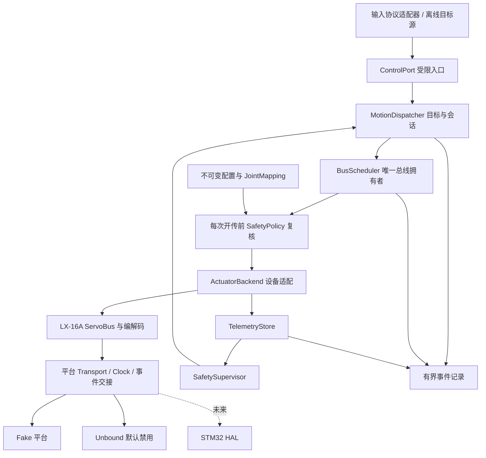

# 控制架构与可替换适配层

更新：2026-10-24，Asia/Shanghai。版本：设计候选v0.2；M1细化待用户确认。

用户已接受当前sanitizer覆盖限制，但尚未批准M1开发。本文保留总体分层；M1的精确顺序、接口失败语义与验收以[M1执行链与HAL方案](../M1_EXECUTION_PLAN.zh-CN.md)候选为讨论依据。平台/设备/输入的新模块仍未实现。

本文是待M0汇报讨论的设计契约，不是已实现模块清单。现有源码只有LX-16A协议、ServoBus、计划型SafetyGate、理想单腿FK/IK和UnboundTransport。M0不实施下述新接口。

## 1. 设计目标与范围

- 单线程轮询核心；有界队列、缓存与每次poll工作量；显式错误，默认拒绝运动。
- M1/M2先支持三关节位置目标和独立线性映射；单腿数学接口保持3DOF。未来四腿由组合层增加，不把全局关节数硬改12。
- 更换MCU/OS、电机协议或输入协议时，修改对应适配层及能力/配置，复用控制状态机与验收契约。
- 当前只实现LX-16A后端及fake合同测试。PWM/CAN/其他总线电机、速度/力矩模式、真实遥控链路、STM32 HAL和耦合模型均不在M0—M2实现范围。
- 更换设备不等于换类名即可安全运行；能力、量化、时延、限位、反馈、停止语义及硬件验证必须重新满足控制配置。

## 2. 依赖与所有权

ControlRuntime拥有控制对象并在单一线程调用；BusScheduler是唯一能要求后端开始事务的组件。ActuatorBackend拥有特定设备协议实现，其中LX-16A后端封装现有ServoBus。适配器不另起线程、不保留可绕过调度的运动队列、不自动重试、不在构造/初始化时运动或写持久配置。

正常应用只看ControlPort及只读快照；测试可显式访问低层类。此封装是防止误用的架构边界，不宣称能防御恶意C++调用者。

## 3. 三种独立适配边界

| 边界 | 职责与契约 | 不承担 |
|---|---|---|
| 平台HAL | 单调Clock、非阻塞字节Transport、UART完成/收发方向、abort和缓冲生命周期、错误/溢出事件；未来急停事件交接 | 电机协议封包、关节标定、目标授权、步态 |
| 执行器设备适配ActuatorBackend | 能力描述、设备地址、位置单位量化、受支持读写操作、协议封包/解析、反馈类型与发送结果 | 用户输入接受、看门狗续期、绕过软件限位或配置验证 |
| 输入协议适配InputAdapter | 外部消息解码、长度/范围/版本/序号/时钟映射、来源与有效性，产出规范化意图 | 直接访问设备、自动arm、刷新旧指令创建时间、替代核心安全校验 |

输入协议适配与平台HAL并列设计，避免把无线报文或遥控语义塞入UART驱动。未来改变串口/网络媒介时，也能分别替换输入字节来源和消息解析。

### 平台HAL合同

- Clock提供同一时基的uint32单调毫秒。时间窗口必须为1..2^31-1ms；差值按无符号回绕解释，未来/非法窗口拒绝。不能将壁钟或未转换的远端时钟送入核心。
- begin_tx只能在当前授权复核后执行；调用可能已把部分字节上线路，即使随后报告失败也不能推定“未发送”。
- TX Complete必须表示最后停止位发出。DMA完成不是线路完成。方向切换由真实平台在正确事件点完成；enter_rx不得丢弃已到达回复。
- abort返回前必须解除调用者发送缓冲的全部借用，结果另报线路静默或未知。借用型驱动无法保证释放时，必须改为其自身持久缓冲或保持未就绪；仅标故障后释放仍被DMA使用的内存不满足合同。正常清理、取消、销毁和线路未知分别验证，详见M1方案6.1。
- 现有ServoBus在成功完成时也调用abort释放资源，平台清理必须幂等且允许无活动传输；正常清理不应被当成取消故障。若以后拆分release/cancel，两条路径都须证明缓冲生命周期。
- receive接口必须能区分无数据与传输错误/溢出。现有仅返回size_t的接口不能表达全部运行期故障；M1-01b前移最小版本化接口、逐字节到达时间和积压状态，M2再补完整遥测与调度。
- 字节间超时需要接收事件的实际时间依据，不能默认一批积压字节都在poll时到达。平台应提供保留间隔信息的时间戳/超时边界；采用其他方案时须明确并验证服务周期、缓存与超时语义。测试同时覆盖“及时到达但延迟读取”和“实际间隔超时但一次读取”。仅调整expire与receive顺序不足以证明正确。
- 结果属于被接受的事务身份；start拒绝不产生新的成功结果，且不得破坏正在执行事务的状态。response仅在对应事务Reply时有效，恢复后的旧字节/旧快照不能作为新反馈。
- ISR不直接修改核心状态或发命令，只通过平台合同提交有界事件/紧急锁存。实机“撤销与开传”同步必须由平台原子锁存和临界区等明确机制实现并板测；host fake只证明规定的事件次序。

### 设备能力与单位

上层使用逻辑JointId/ActuatorId与rad、rad/s、ms；设备地址、ticks、脉宽、寄存器值仅在后端和配置绑定中出现。当前LX-16A ID 0..253与tick 0..1000仍必须由LX-16A后端检查，不能变成所有电机的全局限制。

能力描述至少包含：支持模式、命令/反馈位置表示与量化、是否有命令ACK、可读位置/温度/电压/加载状态、stop语义、abort与恢复条件、发送长度/保守线路预算。未知能力标Unknown；Unsupported和Unknown都不能伪装成成功。

M1/M2只允许Position模式。缺少配置要求的反馈或停止能力时拒绝使能，不自动降级为开环。未来无反馈PWM电机或力矩电机需要新的控制配置、监督设计及验收，不能自动套用当前配置。

JointMapping描述机构关节rad与执行器坐标之间的关系；后端负责设备原始单位量化。流程为：关节限位→映射→后端可表示值/量化→反向得到实际可发送关节值→再次检查关节限位、步幅和速度→开传。不得将量化后检查隐藏在无法由核心观察的适配器内部。

配置的硬件绑定包含平台版次、后端/设备型号、映射类型、总线归属和证据摘要。换电机或平台使旧硬件验证及配置版本失效；不能保留ready标志直接运行。

## 4. 数据与接口草案

以下是语义合同，具体C++签名由M1任务在允许范围内落实；不在本轮提交空壳接口充当实现。

| 对象/操作 | 必需数据和语义 |
|---|---|
| ControlIntent | source_id、session_id、sequence、原始created_ms、模式、三关节rad目标、duration_ms；enable/disarm/cancel为明确意图 |
| submit_target | 只接受有效来源、当前会话、未重放且新鲜的目标；返回Accepted/Rejected/QueueFull/Superseded等类型化结果；不直接发送 |
| ConfigSnapshot | schema、版本、摘要、单位、硬件/模拟域、映射与能力需求、验证证据；提交成功后整体替换 |
| FeedbackSample | actuator/joint、来源、raw及单位、转换rad、请求开传/接收时间、有效/错误/超时和不确定性；预测不算测量 |
| PreparedOperation | 内部、不可由应用构造；绑定原目标身份/时间、会话与配置代际、量化结果、关节及操作种类；排队本身不持久授权 |
| Backend prepare | 无I/O地检查能力、映射/量化并返回可观察结果；不开始运动 |
| Scheduler dispatch | 选择一次操作后取得当前状态并复核，再由唯一后端开始事务；不得把复核后的原始帧交给另一个队列延迟发送 |
| ExecutionStatus | Pending/Started/WriteSent/FeedbackObserved/AtTarget/Cancelled/Fault；按关节记录已发/未发/未知，整个目标有汇总 |

M1先使用内部规范化目标源。M2只提供离线输入/回放入口，真实输入协议的重复/乱序/鉴权等实现属于后续遥控阶段；未来适配器仍不得绕过核心身份、新鲜度及模式规则。

序号/代际使用明确宽度与溢出策略。建议内部会话/配置/目标代际用uint64并在耗尽前拒绝继续，不能自然回绕复活旧目标；计时仍按uint32合同。跨进程重启清空队列，重新建立会话并保持disarmed。

## 5. 状态与目标替换

安全状态、总线状态和目标执行状态分开记录，避免一个success位混合含义。

| 事件 | 安全/目标行为 |
|---|---|
| 启动 | Disarmed，真实配置无效，Unbound拒绝I/O |
| arm | 当前配置、能力、验证证据和反馈均通过才进入Armed；不自动启动力矩或发送运动 |
| 首次arm后的输入 | 建立一次首输入截止期；没有新目标则超时故障；已经Armed时重复arm不延长截止期 |
| 接受新目标 | 新身份且原始时间有效才更新输入存活依据；数值相同但确为新控制输入可接受 |
| 重复/旧目标、逐帧复核、遥测 | 不续目标看门狗，不修改原始created_ms |
| disarm/cancel | 代际改变；清空未发送工作；取消活动事务进入恢复契约；已上线路部分结果未知 |
| fault/watchdog | Fault锁存、撤销目标、禁止新move；允许专用受限停止尝试 |
| clear_fault | 只回到Disarmed；无自动arm或重发；总线恢复是另一个必须满足的条件 |
| 配置更新 | 仅Disarmed时全量校验并原子替换；失败保留上一完整配置且不arm；成功提升版本、撤销旧计划 |
| 新会话 | 新代际、清队列；不继承旧控制输入存活时间或运动许可 |

M1只允许一个发送中的目标，重复目标拒绝；占用时的新目标返回Busy且不续看门狗，无待处理槽。三帧发送完即释放目标槽，不等待舵机duration；保留最后发送记录和可能受影响设备，看门狗仍持续监督。M2可增加一个最新待处理目标槽：用新目标替换未执行的旧待处理目标并记录Superseded；已经开始的三帧批次不因普通新目标而混拼。每帧仍须通过时效/反馈检查；待处理目标过期则拒绝，不改时间。

看门狗存活依据必须绑定被接纳的新控制输入及其原始时刻；不能仅凭更大的序号或本机入队时刻把旧输入变新。首次arm到第一输入的宽限与持续控制的看门狗是两个显式概念。测试参数只在synthetic域设定。

## 6. 单轮执行顺序与撤销边界

1. 获取当前单调时刻，消费有界安全/输入事件；紧急撤销事件优先。
2. 处理活动事务状态，消费有界RX，更新遥测与结果；推进超时和恢复状态。
3. 执行反馈/输入时效与监督检查，必要时锁存故障并撤销未发工作。
4. 若总线可用，选择一项受限stop、运动或读请求；运动在真正开传前重新读取状态/代际/反馈，检查能力、量化限位、步幅、速度和总线恢复状态。
5. 复核到开始发送之间不再运行任意用户回调、不重入、不放入后端隐藏队列。平台紧急锁存必须在实际开传边界参与同步；这一平台性质不能由普通单线程C++假定。
6. 记录有界事件并返回；不执行文件写入、网络或阻塞等待。

时刻不能只在循环开始采一次然后用于无限工作。工作量有界且开传前更新时间；当测试在开传前注入撤销/时效变化时，尚未启动的帧必须拒绝。

## 7. 部分失败、停止与恢复

开始发送后不能回滚。记录至少每关节NotStarted/StartedOutcomeUnknown/WriteSent以及观察到的反馈。第一个运动帧已开始后，后续校验、begin_tx或poll失败，均撤销剩余正常运动并进入故障流程。UART完成后enter_rx或清理失败，保留WriteSent并另记故障；不得抹掉已观察到的发送里程碑。

受限stop仅可针对已配置设备、在同一总线所有者下有界尝试；默认不unload。现有事务先取消并释放，若总线恢复条件不足，stop也不能强行插入。停止失败/不支持/无法证明完成时暴露PhysicalStopRequired或UnknownActuatorState；WriteSent不是ACK、到位或物理停止。

LX-16A无事务序号。超时后不自动重发同ID同命令；clear_rx只能删除已到字节，不能证明未来不会迟到。恢复需要平台/设备证据条件。fake中明确注入证据用于合同测试；真实静默时间和恢复依据等待实测，不能用测试常量作为硬件默认。

## 8. 遥测、配置与日志

LX-16A响应没有采样时间：记录请求开传和收包时间，并在“设备采样发生于请求处理窗口内”的显式假设下以请求开传时间保守计算样本年龄；没有证据不能声称精确采样时刻。快照采用最旧有效样本，保留逐项时间与不确定性。synthetic与physical来源不互换。

配置解析在主机/非控制环完成，核心只接收通过结构校验的类型化候选，再执行语义和能力检查；未知schema、字段缺失、重复地址、错误单位、无穷/NaN、范围/映射冲突均拒绝。新配置不可部分更新。M2文件格式在实施规格中选定一种，不引入通用动态插件系统。

事件环记录构建/配置摘要、事件序号、原始输入、会话/目标代际、事务、反馈时间、发出/取消/未知状态与丢日志计数。主机负责导出；回放仅用fake并保存初始状态、输入次序、时间推进、种子。日志丢失后不能宣称完整确定性重建，损坏输入不能作为真实运动命令。

## 9. 现有代码迁移与验收归属

| 现状 | 计划迁移 | 阶段/验收 |
|---|---|---|
| SafetyGate直接包含LX-16A并产出Frame | 分离通用校验/目标与设备量化、编码；保留量化后复核 | M1-02/03；D08/D14、A01/A02 |
| ServoBus公开raw start | 包在LX-16A后端内；应用只见ControlPort | M1-03；D01–D14 |
| Transport只有UART字节抽象 | M1落地typed错误/取消/RX时间/事务/门控合同；上层通过设备能力接口适配不同总线 | M1-01b host合同；M2能力配置/调度；F/S、A03 |
| JointTargetSource只有sample | 规范化输入身份/时刻/来源；未来InputAdapter在其前解析 | M1身份；M2离线回放；D09/D10/L、A04 |
| JointCalibration混合servo_id/ticks与关节参数 | 保持兼容迁移，分离逻辑关节、硬件绑定、JointMapping与设备量化 | M1最小拆分，M2配置；C01–C07 |
| 反馈只有合并时间和bool | TelemetryStore保留逐设备时间/有效性/来源/能力 | M2-01；S03–S09 |

新增抽象验收编号（后续实施才运行）：

- A01：控制层公共数据不含LX-16A Frame/Command；后端替身不需要伪造LX-16A字节即可验证拒绝/调度行为。
- A02：设备量化改变后仍重新检查实际关节限位/速度；不能只校验量化前目标。
- A03：未知/缺失能力被拒绝；切换后端、映射或硬件身份使旧配置验证与目标失效。
- A04：离线不同输入适配替身产出同一规范化意图走同一入口；重复/旧输入不因解码或回放续命。
- A05：构造、配置加载和后端连接不自动运动、写持久参数或开启扭矩；无隐藏运动队列/重试。

M1验收A01/A02/A05与最小能力拒绝；M2补全A03/A04配置与回放场景。其他电机/真实输入协议须各自通过同类合同与专项测试后才能声明支持。

## 10. M0后待用户确认的设计细化

用户已确认高层方向并接受M0的sanitizer限制。当前讨论候选为[M1详细方案](../M1_EXECUTION_PLAN.zh-CN.md)：单活动目标/Busy不续期、首输入独立宽限、配置失败原子保留、最小HAL错误/时间合同前移。确认后才开始M1。现有SafetyGate配置失败会使配置无效，迁移必须有明确回归，不能把当前行为描述成已符合新契约。
